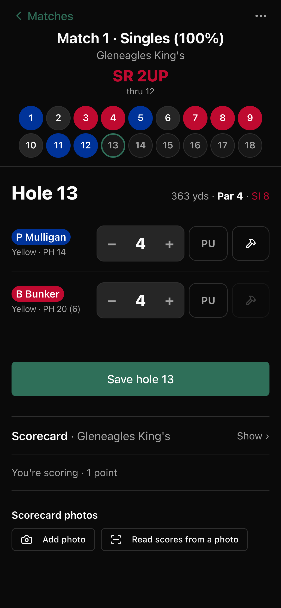
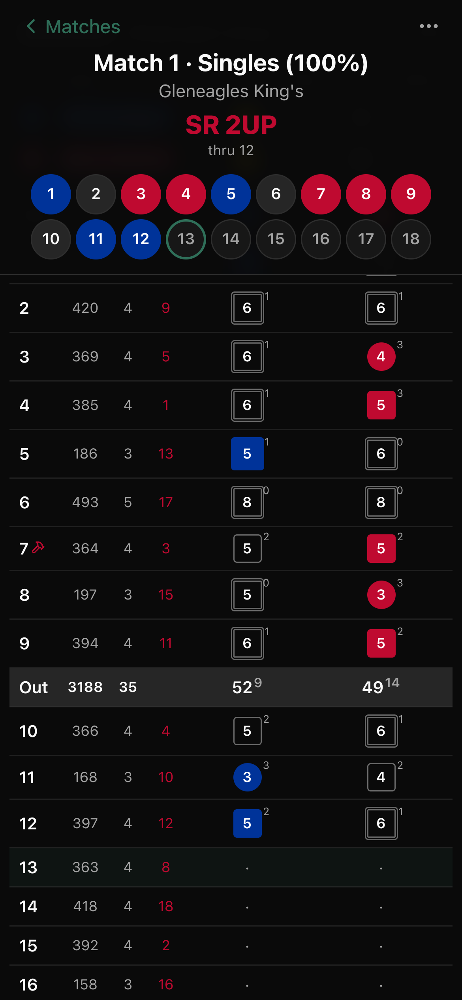
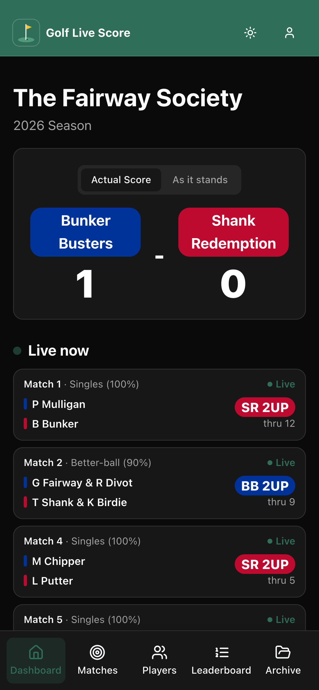
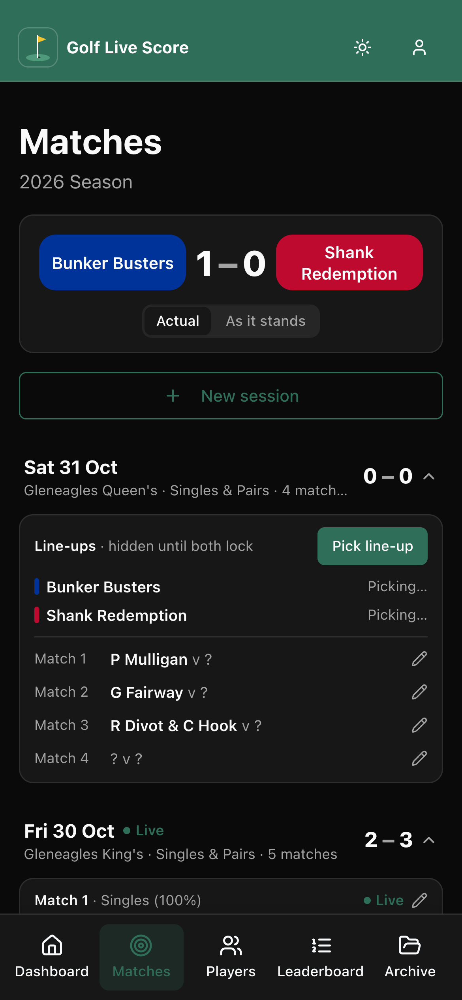
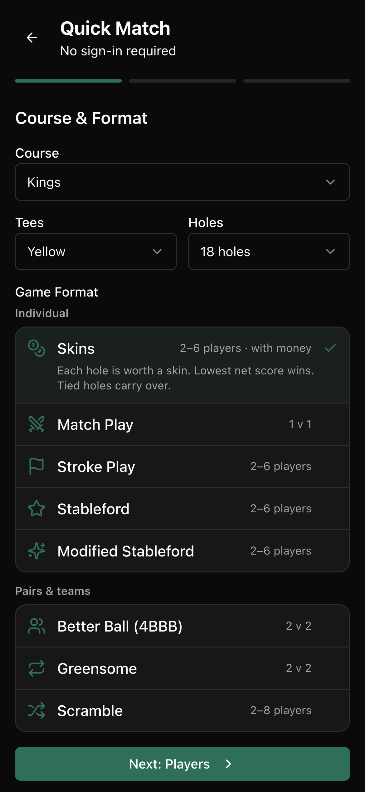
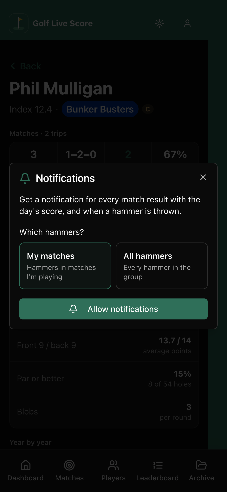

# Golf Live Score

A live scoring app for a golf group's annual trip to Gleneagles and its weekend league, so everyone can see who's winning without shouting across three fairways.

## Why I built it

Every year our group heads to Gleneagles for a Ryder Cup style team trip, and for years the scoring lived on paper cards, a group chat and one heroic spreadsheet. Nobody knew the score until the bar, and by then nobody agreed on it. I'm not a developer (I work in B2B SaaS sales), but I wanted a proper app, so I built one.

It's live at [golflivescore.co.uk](https://golflivescore.co.uk) and gets used for real on the trip and in a weekend league through the year.

## What it does

**Live team matches**
- Captains set up each session: singles, better ball pairs or foursomes, the handicap allowance and the tees.
- Line-ups are blind. Each captain locks theirs in for the whole session before either side sees the other's, so no tactical peeking.
- Scores go in hole by hole on +/− steppers, and the match state (3 UP, all square, 2&1) updates on every phone in the group the moment a hole is saved.
- Matchplay with handicap strokes by stroke index, plus stableford points for every round. Picked-up holes are handled properly.
- A "football score" option plays all 18 holes and gives a result like 7 - 4 instead of 4&3.
- **The hammer:** each player gets one per match to double the value of a hole. Hammers can't be hammered back, partners throwing together make it ×4, and a match isn't over while the losing side still has hammers that could rescue it. Chaos, as intended.

**Works with no signal**
- Golf courses are famous for their 5G coverage. Scores are saved on the phone and sent automatically when signal comes back, with a clear banner telling you how many holes are waiting.
- If two people score the same hole, the last one entered wins.

**Phone notifications**
- Every match result, with the day's running score, goes to the whole group.
- Hammers get announced too, either for all matches or just your own.
- Works in the browser, as a home-screen app and in the iPhone app.

**Google Sheets sync**
- The group's long-standing trip spreadsheet stays in the loop: pairings go across once both captains have locked in, results go as each match finishes, and full scorecards sync on demand.
- Handicaps and teams can be imported back from the sheet, with a preview before anything changes.

**Scorecard photos**
- Snap the paper card at the end of a round and the app reads every player's gross scores off it, as a backup for rounds where someone "forgot" to use the app. The scorer checks it before anything is saved.
- Photograph a course's scorecard and the app fills in the pars, stroke indexes, yardages and hole names.

**Quick Match**
- A casual round outside the trip: skins (with money), match play, stroke play, stableford, modified stableford, better ball, greensome or scramble, for 9 or 18 holes.

**Stats and history**
- Dashboard with a trip countdown, the honours board, top players, best rounds, birdie leaders, course records and hole-by-hole stats.
- Player records, league standings by season, and an archive of past trips and seasons (migrated from the old spreadsheets and the original app).
- Course search across UK clubs, pulling tee ratings, par and stroke index for each hole.

**Built for a group, not an IT department**
- Players log in with a group join code and tap their name. No passwords to forget on the first tee.
- Lose your phone and an admin approves the new one.
- A separate admin site, locked behind Cloudflare Access, for seasons, courses, phones and the sheet.

## Screenshots

| Live match | Scorecard | Dashboard |
| --- | --- | --- |
|  |  |  |

| Line-ups | Quick Match | Notifications |
| --- | --- | --- |
|  |  |  |

<!-- Drop PNGs into docs/screenshots/ with these names (phone-width shots look best). -->

## How it was built

I built this with [Claude](https://claude.ai) as my developer. I set the direction, wrote up the rules (there were many debates about the hammer), tested it on real rounds and decided what shipped. Claude wrote the code.

It runs entirely on Cloudflare:
- **Frontend:** React, Vite, Tailwind and shadcn/ui, served from Cloudflare Workers.
- **Backend:** a Cloudflare Worker API built with Hono.
- **Database:** Cloudflare D1 (SQLite), with numbered migrations.
- **Live updates:** a Durable Object per group holds a WebSocket to every open screen.
- **Photos:** Cloudflare R2.
- **Notifications:** Web Push, plus Apple Push for the iPhone app.
- **iPhone app:** a Capacitor shell around the web app.
- **Sheet sync:** a Google Apps Script web app inside the trip spreadsheet.

The migration meant exporting every player, match and round from Base44, merging duplicate players, rebuilding the scoring engine so every match replays from its hole-by-hole data, and checking every old result still came out the same. Some historic scorecards were rescued from photos of the paper cards.
